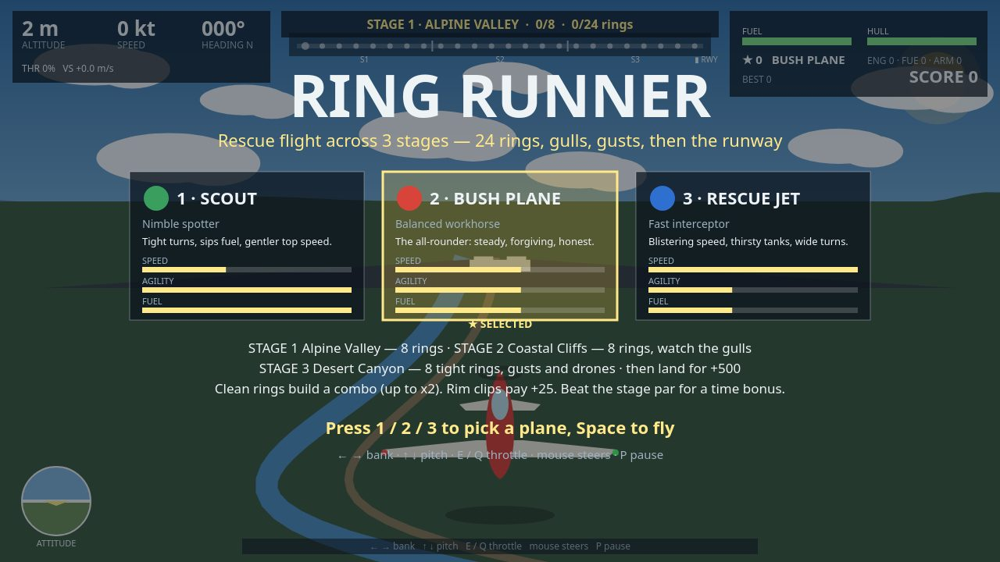

# Ring Runner — 3-Stage Rescue Flight

[](https://make.fun/bounty/best-flight-game-20261126-0057)
[](https://make.fun/bounty/best-flight-game-20261126-0057)
[](https://make.fun/bounty/best-flight-game-20261126-0057)

A complete pseudo-3D flight game in the browser. Pick one of three planes,
fly 24 rings across three stages — alpine valley, coastal cliffs, desert
canyon — buy upgrades between stages, dodge gulls and drones, fight the
wind, then set her down on the runway.



## How to play

Open `game/index.html` in a browser (or serve the `game/` folder with any
static server), pick a plane with **1 / 2 / 3**, then press **Space** or
click to fly.

| Control | Action |
| --- | --- |
| 1 / 2 / 3 | Pick a plane (title) · buy an upgrade (shop) |
| ← → (or A / D) | Bank and turn |
| ↑ ↓ (or W / S) | Pitch up / down |
| E / Q (or PgUp / PgDn) | Throttle up / down |
| Mouse | Steer toward the pointer |
| Space / click | Start, continue from the shop, restart |
| P | Pause (R restarts from the pause menu) |

## The three aircraft

| Plane | Speed | Agility | Fuel | Character |
| --- | --- | --- | --- | --- |
| **Scout** | ★★ | ★★★★★ | ★★★★★ | Tight turns, sips fuel, gentler top speed |
| **Bush Plane** | ★★★ | ★★★ | ★★★ | The balanced all-rounder |
| **Rescue Jet** | ★★★★★ | ★★ | ★★ | Blistering speed, thirsty tanks, wide turns |

## The three stages

1. **Stage 1 · Alpine Valley** — 8 rings over the valley. Throttle
   discipline wins: too fast and the turns go wide.
2. **Stage 2 · Coastal Cliffs** — 8 rings over sea cliffs. Gulls drift
   across the course — a strike damages the hull and breaks your combo.
3. **Stage 3 · Desert Canyon** — 8 tighter rings, gusting crosswinds that
   shove the plane sideways, and patrol drones to dodge.

Then **Final Approach** — line up on the runway, slow below 70 m/s, set
her down gently (+500, plus a fuel bonus for what is left in the tanks).

## Scoring

- Ring pass **+100** (× combo multiplier, up to **×2** for 10+ clean
  rings in a row), dead-centre pass **+50** and **+1 star**.
- Rim clip (near miss) **+25** — close counts for something.
- Stage time bonus: beat the 85 s par, **+4 per second** under par.
- Landing **+500** plus **+1 per percent of fuel left**.

## The upgrade shop

Between stages the shop opens: the stage is scored, fuel is refilled,
and stars earned (centre passes + stage completions) buy upgrades that
last the rest of the run:

- **Engine** (★3) — +7% top speed per level.
- **Fuel Tank** (★2) — +25 fuel capacity per level, refilled on purchase.
- **Armor** (★2) — damage taken ×0.65 per level.

## HUD

Stage progress bar with all 24 rings, a course strip showing the whole
route with the plane and runway, speed and altitude tapes, fuel and hull
gauges, combo meter, stars, owned upgrades, a wind readout, and a
next-ring distance. The pause menu and the crashed/landed screens show a
full debrief: rings, best combo, time, stars, upgrades, obstacles hit.

## Running the tests

The flight model and the autopilot are plain ES modules with no browser
dependency, so they can be driven headlessly:

```bash
node /tmp/v2-test.mjs 1 bush   # full 3-stage sortie + landing
```

The autopilot flies the whole course on seed 1 and lands it: Bush Plane
24/24 rings, best combo ×2.0, **5860 points** (Scout: 6330); v1 scored
3010 on the same course. Across 6 seeds × 3 aircraft the autopilot lands
18/18 runs, scoring 5500–6530.

Screenshots are staged from the same code with `?shot=<name>&seed=1`
(see `shots.json`): the autopilot flies the game in a real browser and the
page sets `window.__shotReady` when the scene is framed.

## Structure

```
game/
  index.html        page shell (1280×720 canvas, HUD)
  main.js           game loop, screens (title/shop/pause/debrief), persistence
  src/
    config.js       all tuning in one place (aircraft, stages, upgrades, palettes)
    random.js       seeded RNG + 1-D value noise (deterministic world)
    terrain.js      heightfield, valley, 24-ring course, obstacles, runway
    flight.js       flight model: lift, stall, fuel, damage, wind, combo, shop, landing
    input.js        keyboard + mouse + pause
    render.js       sky, ridges, river, road, runway, rings, obstacles, plane, HUD
    autopilot.js    intercept-steering demo pilot (also drives screenshots)
  screenshots/      4 staged shots (cover, rings, coastal, shop)
main.ts             hand-in: copies game/ + screenshots/ to /output, writes dossier.json
serve.ts            tiny dev server (bun/node) for local play
```

The world is fully deterministic for a given seed: the same seed always
builds the same valley, the same rings, the same gusts and the same
obstacles. The hand-in is deterministic too: running `main.ts` twice with
`MAKEFUN_OUTPUT_DIR` produces byte-identical output.

## Licence

MIT — see [LICENSE](LICENSE).
